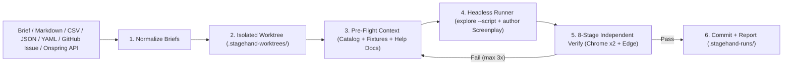

# Stagehand

**Stagehand** is the backstage CLI and harness-agnostic test-authoring orchestrator for `OnspringEnd2EndTests`.

Just as a theater stagehand prepares the set so Actors can perform, Stagehand prepares isolated git worktrees, discovers existing Screenplay building blocks, searches local Onspring Help Center docs, inspects live Onspring pages, hands structured prompts to your preferred headless coding CLI, and independently verifies every generated test before committing it.

## Quick Start

> [!NOTE]
> Make sure workspace packages are built once (`npm run build:packages`) and `.env` is configured for your target environment (such as `ALPHA`).

Check which AI runners are installed on your `PATH`:

```sh
npm run stagehand -- runners
```

Preview how Stagehand parses a GitHub issue or backlog file:

```sh
npm run stagehand -- ingest --issue 325
```

Do a zero-risk dry run:

```sh
npm run stagehand -- run --issue 325 --shared-branch feat/survey-answer-field --domain fields --dry-run --cleanup-worktree
```

Launch a real autonomous run:

```sh
npm run stagehand -- run --issue 325 --shared-branch feat/survey-answer-field --runner opencode --domain fields --cleanup-worktree
```

## How Stagehand Works



When `--shared-branch <name>` is used on a multi-test batch, each passing test commits onto the shared branch and hands its changed files forward to the next test brief (`## Prior Batch Commits on This Branch`), so `Test-654` automatically builds on the helpers and spec created for `Test-653`.

## Practical Recipes

### Run a Single Brief

```sh
npm run stagehand -- run --brief "Test-678 Add a new public campaign" --domain survey --runner opencode --commit --cleanup-worktree
```

Creates an isolated `stagehand/test-678-...` branch, verifies everything, commits on pass, and removes the temporary worktree.

### Run a GitHub Feature Issue Checklist on One Branch

Issues containing unchecked `- [ ] Test-NNN ...` checklist items automatically expand into sequential briefs (completed `- [x]` items are skipped):

```sh
npm run stagehand -- run --issue 322 --shared-branch feat/slack-message-history-report --runner opencode --domain systemReports --cleanup-worktree
```

### Resume an Interrupted Batch in One Command

If your machine sleeps, the runner is interrupted (`Ctrl+C`), or item #3 fails:

```sh
npm run stagehand -- run --issue 322 --shared-branch feat/slack-message-history-report --runner opencode --domain systemReports --resume --cleanup-worktree
```

`--resume` automatically:

1. Detects the existing `.stagehand-worktrees/<branch>` checkout, safely resets partial uncommitted edits, and rebuilds packages.
2. Scans existing commits and `tests/**/*.spec.ts` to skip already-completed `Test-NNN` cases.
3. Preloads the commits already landed on that branch into subsequent prompts and resumes from the first remaining test.

### Control Terminal Output & Inspect Logs

- **Default:** Displays a calm live spinner with elapsed time, changed file count, and the runner's latest tool/action while writing 100% of raw stdout/stderr to `.stagehand-runs/<runId>/attempt-<n>-runner.log`.
- **`--verbose`:** Streams raw runner output live framed with a `│` gutter.
- **`--quiet`:** Suppresses live progress output on `stderr`.

### Ingest From Files or the Onspring REST API v2

Stagehand normalizes briefs from six sources:

| Source           | Auto-Detection / Flag                                                           | Example                                                                              |
|:-----------------|:--------------------------------------------------------------------------------|:-------------------------------------------------------------------------------------|
| Markdown (`.md`) | Split on `---`, `## Test Brief` / `## Test-NNN`, or `- [ ] Test-NNN` checklists | `npm run stagehand -- ingest --input backlog.md`                                     |
| CSV (`.csv`)     | RFC-4180 CSV (quotes, commas, multiline cells)                                  | `npm run stagehand -- ingest --input tests.csv`                                      |
| JSON / YAML      | Single object, array, `{ briefs }`, or multi-doc YAML (`---`)                   | `npm run stagehand -- ingest --input batch.yaml`                                     |
| GitHub Issues    | `gh` CLI (`--issue`, `--label`, `--query`, optional `--repo`)                   | `npm run stagehand -- ingest --label e2e-test --limit 10`                            |
| Onspring v2 API  | Single record, filtered query, or report data (`ONSPRING_CORP_*`)               | `npm run stagehand -- ingest --record-id 1234 --onspring-config ./onspring-map.json` |

Add `--markdown` to `ingest` for full Markdown brief cards, or `--json` for machine-readable output.

<details>
<summary>Example Onspring field-mapping JSON (<code>--onspring-config</code>)</summary>

```json
{
  "appId": 100,
  "reportId": 250,
  "fields": {
    "testId": 1001,
    "title": 1002,
    "domain": 1003,
    "preconditions": 1004,
    "steps": 1005,
    "assertions": 1006,
    "cleanup": 1007
  },
  "columns": {
    "testId": "Test ID",
    "title": "Name",
    "assertions": "Expected Result"
  }
}
```

</details>

### Land Finished Tests Onto Your Working Branch

When a `--shared-branch` batch completes, your branch remains clean and untouched until you review the generated code:

```sh
# Inspect what Stagehand built
git log --stat main..feat/survey-answer-field

# Bring the commits onto your current branch (or merge / push for PR)
git cherry-pick <first-sha>^..<last-sha>
```

Or pass `--draft-pr` during `run` to push the finished branch and open a draft pull request using `gh pr create --draft`.

## Standalone Developer Tools

Stagehand subcommands are also useful directly during everyday manual Playwright & Screenplay development:

- Find existing Screenplay targets, tasks, questions, controls, models, and fixtures

```sh
npm run stagehand -- catalog --domain fields
npm run stagehand -- catalog --kind fixtures
```

- Search local Onspring Help Center Markdown docs:

```sh
npm run stagehand -- help-search "survey answer field" --top 5
```

- Run a quick pre-authenticated Playwright inspection script:

```sh
npm run stagehand -- explore --route /Admin/Survey --script ./tmp-inspect.js
```

> [!NOTE]
> Add `--headed` to watch the browser visually, or `--engine cli --launch` for an interactive `playwright-cli` session.

- Run the full 8-stage quality gate on any spec:

```sh
# Full gate: clean package build, unit tests, Prettier, tsc, zero-warning ESLint, TS AST guardrails, Chrome x2, Edge
npm run stagehand -- verify tests/fields/surveyAnswerField.spec.ts

# Fast static check during active edits
npm run stagehand -- verify tests/fields/surveyAnswerField.spec.ts --skip-e2e --no-clean
```

## Safety & Git Guarantees

- Runs happen inside `.stagehand-worktrees/<slug>` (unless you explicitly pass `--in-place`).
- Each worktree receives its own `node_modules/` directory where third-party dependencies are junctioned to the root checkout while `@stevanfreeborn/*` workspace packages point directly to that worktree's `packages/*`. Building modified UI packages inside a worktree never overwrites your main checkout's compiled packages.
- `--cleanup-worktree` refuses to delete a worktree that still has uncommitted changes unless they were already committed or created by `--dry-run`.
- Branches stay local unless `--draft-pr` is explicitly passed.

## Command Reference

| Command       | Purpose                                                                   | Key Options                                                                                                                                                                                                                                                                                                          |
|:--------------|:--------------------------------------------------------------------------|:---------------------------------------------------------------------------------------------------------------------------------------------------------------------------------------------------------------------------------------------------------------------------------------------------------------------|
| `catalog`     | AST inventory of UI modules, models, `FakeDataFactory`, fixtures, tags    | `--domain <name>`, `--kind all\|targets\|tasks\|questions\|controls\|models\|fixtures\|tags`, `--json`                                                                                                                                                                                                               |
| `help-search` | BM25 + bigram search of local Help Center Markdown docs                   | `<query>`, `--docs-dir <path>`, `--top <n>`, `--max-chars <n>`, `--json`                                                                                                                                                                                                                                             |
| `explore`     | Authenticated UI probe (`--script`) or interactive `playwright-cli`       | `--route <path>`, `--script <file>`, `--engine node\|cli`, `--headed`, `--launch`, `--refresh-auth`, `--max-age <min>`, `--json`                                                                                                                                                                                     |
| `verify`      | Static checks, TS AST Screenplay guardrails, & sequential Chrome/Edge E2E | `[spec]`, `--skip-e2e`, `--no-clean`, `--no-fail-fast`, `--repeat <n>`, `--browsers both\|chrome\|edge`, `--quiet`, `--json`                                                                                                                                                                                         |
| `ingest`      | Normalize test briefs from Markdown, CSV, JSON, YAML, GitHub, or Onspring | `--input <file>`, `--source`, `--domain`, `--issue`, `--label`, `--query`, `--repo`, `--record-id`, `--report-id`, `--app-id`, `--filter`, `--onspring-config`, `--field-map`, `--markdown`, `--json`                                                                                                                |
| `runners`     | Show installed headless coding CLIs on `PATH`                             | `--json`                                                                                                                                                                                                                                                                                                             |
| `run`         | Execute single or batch test authoring with verify & bounded retries      | `--brief`, `--brief-file`, `--shared-branch`, `--resume`, `--fail-fast`, `--runner`, `--runner-cmd`, `--model`, `--domain`, `--max-attempts`, `--base-ref`, `--in-place`, `--install`, `--skip-e2e`, `--no-fail-fast`, `--commit`, `--draft-pr`, `--cleanup-worktree`, `--verbose`, `--quiet`, `--dry-run`, `--json` |

### Build & Test Scripts

| Script                     | Description                                               |
|:---------------------------|:----------------------------------------------------------|
| `npm run build:stagehand`  | Compile `tools/stagehand` TypeScript CLI & tests          |
| `npm run test:stagehand`   | Run Stagehand's offline `node:test` suite                 |
| `npm run clean:stagehand`  | Remove compiled `tools/stagehand/dist` and `.tsbuildinfo` |
| `npm run stagehand -- ...` | Run the compiled CLI                                      |

## Environment Variables

| Variable                                                                 | Purpose                                                                                      |
|:-------------------------------------------------------------------------|:---------------------------------------------------------------------------------------------|
| `TEST_ENV`, `<ENV>_INSTANCE_URL`, `SYSADMIN_*`                           | Target Onspring instance and credentials used by `explore` and Playwright E2E `verify`       |
| `ONSPRING_HELP_DOCS_DIR`                                                 | Path to local Onspring Help Center Markdown docs for `help-search` and pre-flight context    |
| `ONSPRING_CORP_API_URL`, `ONSPRING_CORP_API_KEY`, `ONSPRING_CORP_CONFIG` | Optional Onspring REST API v2 URL, API key, and default field-mapping JSON path for `ingest` |
| `NO_COLOR`, `FORCE_COLOR`                                                | Standard terminal ANSI color overrides                                                       |

## Troubleshooting

- **Auth state expired during `explore`:** Pass `--refresh-auth` (or lower `--max-age 0`) to regenerate `.auth/sysAdmin.json`.
- **Need to see everything the runner did:** Open `.stagehand-runs/<runId>/attempt-1-runner.log` or run with `--verbose`.
- **Unsure which `--domain` folder to pass:** Run `npm run stagehand -- catalog` or inspect folder names under `packages/onspring-ui/src/`. Notice Stagehand also auto-infers secondary domains mentioned in brief titles.
- **Colors/Unicode box characters look off in a dumb terminal:** Stagehand automatically falls back to plain ASCII when `TERM=dumb` or `NO_COLOR=1`.
